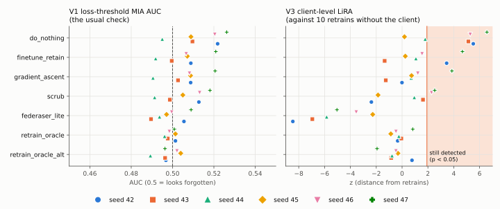
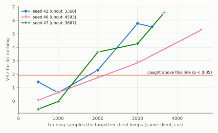
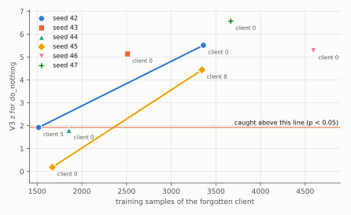
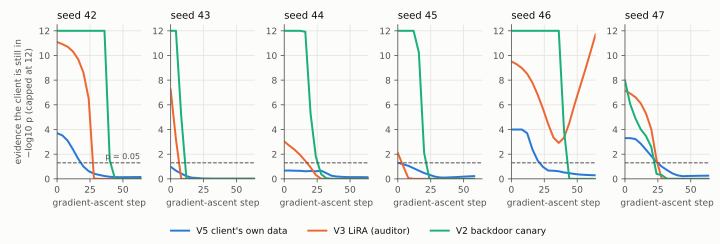
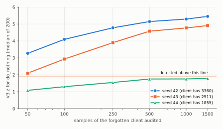

# Proof of Forgetting

**When a federated client asks to be forgotten, can anyone prove that it was?**

Rules such as the GDPR's right to erasure have made "remove my data from your
model" a real request, and machine unlearning is the answer. In federated learning the server says it has "unlearned" a
client, and backs that up with a test showing the client can no longer be
detected in the model. This project audits those tests rather than the
unlearning methods: it runs each test against a server that **did nothing at
all**, against genuine retrains without the client, and against a **dishonest
server** that tries to fake forgetting.

> Complete: CIFAR-10 on six seeds, a controlled client-size experiment, three
> longer-trained federations, and PathMNIST on three seeds. Every number below comes from
> `results/ledger.jsonl` (a test fails if any reported number is missing from it).
> The narrative is in [docs/FINDINGS.md](docs/FINDINGS.md); every number with the
> run it came from is in [docs/RESULTS.md](docs/RESULTS.md), generated by
> `scripts/report.py` and never edited by hand.
> The paper is in [paper/](paper/) (`main.tex`; see [paper/SUBMIT.md](paper/SUBMIT.md)).

## What I found

ResNet-20, 10 non-IID clients, FedAvg; one client asks to be forgotten.
CIFAR-10 on seeds 42 to 47 (plus two runs that forget a different client,
twelve that cut the forgotten client to fewer samples, and three trained for
70 rounds instead of 30), and PathMNIST on seeds 42 to 44.



| | Finding | Evidence |
|---|---|---|
| 1 | **The usual check is blind.** Loss-threshold membership AUC reads 0.48–0.55 for every model, including a server that did no unlearning, on both datasets | every run |
| 2 | **Client-level LiRA is not, if the client is large enough, and almost never accuses a genuine retrain.** It detects the do-nothing server at z 5.1–6.6 on the four CIFAR-10 seeds whose client holds 2500+ samples | 1 false alarm in 70 tests on retrains |
| 3 | **The client's training size is the cause.** Cutting the same client while keeping everything else fixed: no client cut to 1000 samples or fewer was detected, every one with 3000 or more was. Auditing more than a few hundred samples does not help | 0 / 6 vs 6 / 6 |
| 4 | **A better-trained model is easier to audit.** At 70 rounds (76–79% accuracy instead of 61–67%) LiRA's evidence rises on every seed, and a 1855-sample client missed at 30 rounds is detected | 3 / 3 |
| 5 | **A dishonest server beat each check at least once.** It never unlearns, reconstructs the trigger with Neural Cleanse and suppresses it; it got past LiRA on 3 runs and the backdoor canary on 2 | none caught it on all 9 |
| 6 | **The canary also accuses honest servers.** It flagged a genuine retrain 7 times in 18, and 4 in 6 on PathMNIST | 7 / 18 |
| 7 | **The canary usually goes last, not first.** Under gradient ascent the canary usually outlasts LiRA and the client's own test; on two runs it went first | 5 / 9 |
| 8 | **A client can verify forgetting on its own data only if it contributed a lot, or the model is well trained.** The client-side in/out test caught the do-nothing server for every CIFAR-10 client with 3300+ samples, none on PathMNIST, all three at 70 rounds | mixed |









**What it adds up to:** the check most often reported for unlearning cannot tell
a server that forgot from one that did nothing. Checks that can exist, but each
has a price and a blind spot: LiRA needs an auditor who can train models without
the client and only works for clients that contributed enough data (a threshold
that falls as the model is trained further); canaries must be planted in
advance, can be suppressed, and often accuse a genuine retrain. No single check
caught the dishonest server on every run.

**Limits:** one architecture and one non-IID level; most results at 61–67%
test accuracy, with three 70-round runs at 76–79% (E0 only); three PathMNIST
seeds; one attacker. Design changes made after seeing data are listed in
[FINDINGS.md](docs/FINDINGS.md#design-changes-made-after-seeing-data); every
run after seed 42 ran after all of them.

## How it works

Each client splits its own data uniformly at random into an **in** half, which
it trains on, and an **out** half, which it keeps private. Unlearning methods
never see the out half.

| Verifier | Run by | What it measures |
|---|---|---|
| V1 | anyone | loss-threshold membership inference (AUC and TPR at low FPR) |
| V2 | client | does the client's secret backdoor trigger still work? (Sommer et al.; exact McNemar test) |
| V3 | auditor | client-level LiRA (Carlini et al.) against ten retrains without the client and ten with it; Student-t prediction test |
| V4 | server | distance to the retrain oracle, read against a second retrain's distance (noise floor) |
| V5 | client | permutation test on the model's confidence, in half against out half |

| Method | What it does |
|---|---|
| `do_nothing` | returns the original model: the negative control every verifier must catch |
| `retrain_oracle`, `retrain_oracle_alt` | retrain from scratch without the client (two seeds): what every verifier must pass |
| `finetune_retain` | keep training on the remaining clients |
| `gradient_ascent` | push the client's loss up, projected and early-stopped, then recover |
| `scrub` | federated SCRUB (Kurmanji et al.) |
| `federaser_lite` | FedEraser-style calibrated replay of stored updates |
| `canary_suppressor` | **dishonest**: never unlearns; finds the trigger with Neural Cleanse and erases it |

Experiments: E0 every method against every verifier; E2 gradient ascent step by
step; E3 the dishonest server; E4 V5 against client data size; E5 attack
strength.

## Run it

```bash
python -m venv .venv
.venv/Scripts/python -m pip install -r requirements.txt   # Windows; use .venv/bin/python elsewhere
.venv/Scripts/python -m pytest
.venv/Scripts/python scripts/run_e0.py --config configs/smoke.yaml       # ~1 min on CPU
.venv/Scripts/python scripts/run_e0.py --config configs/e0_sanity.yaml   # CIFAR-10, GPU
```

From a finished run, without a GPU:

```bash
python scripts/v3_size_curve.py --run <e0 run id>   # V3 on subsets of the client's samples
python scripts/report.py                            # docs/RESULTS.md
python scripts/figures.py                           # docs/figures/*.svg (needs matplotlib)
```

The experiments ran on free Kaggle T4 GPUs, driven from a laptop by `scripts/kaggle_run.py` and `scripts/kaggle_queue.py`,
which upload the code, run a session, check that the served code matches the
local commit, and pull the results back:

```bash
python scripts/kaggle_run.py run --mode full --seeds 42 --parts clean power
python scripts/kaggle_run.py status
python scripts/kaggle_run.py pull
```

Override any config key from the command line:
`--set seed=43 data.alpha=0.1 fl.rounds=50`. The extra experiments are overrides
of the main one: `data.name=pathmnist data.train_size=50000` (PathMNIST),
`data.forget_size=1000` (cut the forgotten client), `fl.rounds=70` (longer training).

## Reproducibility

- Every random draw is keyed by `(seed, purpose, round, client)`, and training is
  bitwise deterministic on a fixed device (tested).
- Every reported number is written to `results/ledger.jsonl` with its run id,
  config hash, seed and git commit **before** it is written to a CSV. A test
  fails if a CSV contains a number the ledger does not, and the report and the
  figures are built only from CSVs that pass.
- The models use GroupNorm, not BatchNorm, so a model is a pure function of its
  parameters and no membership signal leaks through running statistics.
- Superseded runs are kept, still verifiable, under `results/archive/`.

## Layout

```
configs/      default.yaml and one file per experiment; kaggle.yaml; smoke*.yaml
pof/data/     datasets (CIFAR-10, PathMNIST, synthetic), Dirichlet + in/out partition, canaries
pof/fl/       FedAvg, seeded augmentation, per-sample evaluation
pof/unlearn/  the methods above
pof/verify/   V1 loss MIA, V2 backdoor, V3 LiRA, V4 oracle distance
pof/evaluate.py  per-model scoring shared by every experiment
pof/shadows.py   reference-model bank: resumable, shardable, refuses mismatched setups
pof/stats/    permutation test, bootstrap CIs
pof/ledger.py results ledger and CSV check
scripts/      one script per experiment; report, figures, Kaggle driver
tests/        unit tests, determinism, end-to-end smoke run
```

See [PLAN.md](PLAN.md) for the original research plan and hypotheses.

## License

MIT
